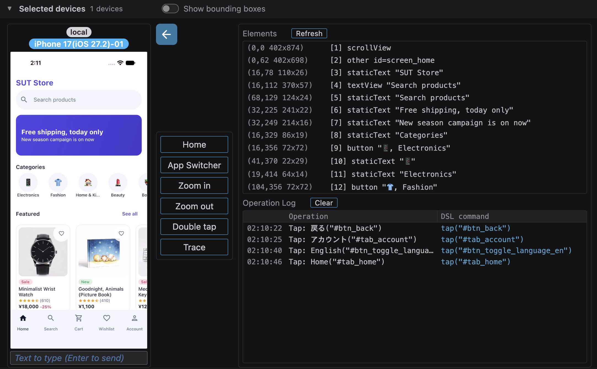
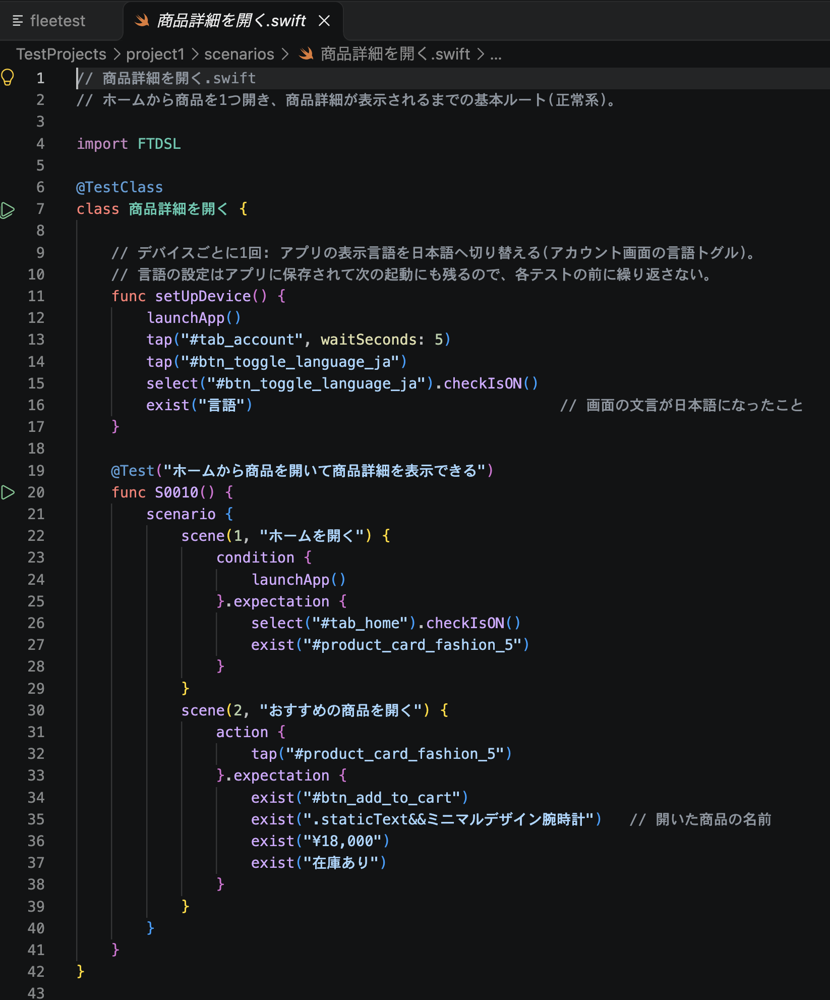

# Quick start

[in Japanese(日本語)](quick-start_ja.md)

The shortest path to installing fleetest and trying out writing and running test scenarios against a sample app.

## 1. Environment

fleetest runs on a Mac with Apple silicon and macOS 26+. For details, see [Environment](overview/environments.md).

## 2. Before you start

Install the following.

- **Xcode 27.2+**
  - <https://apps.apple.com/app/xcode/id497799835>
  - After installing it, launch the Xcode app once and install the required components on the first screen it shows. The iOS Simulator runtime is installed automatically in a later step, when it is needed.
- **Homebrew**
  - <https://brew.sh/>
  - A package manager for macOS. Install it by running the command shown on its website in Terminal.
- **VSCode**
  - <https://code.visualstudio.com/docs/setup/mac>
  - Used to edit and run scenarios and to work with the AI assistant.
- **Android SDK (adb, Command-line Tools)** (if you test Android)
  - <https://developer.android.com/studio/install>
  - Installing Android Studio gives you the Android SDK (including adb) and the Java needed to create Emulators. If Command-line Tools are missing, the AI assistant asks whether to install them in a later step (you can also add them beforehand from the "SDK Tools" tab of the SDK Manager in Android Studio).
- **AI assistant (Claude Code, etc.)**
  - Install an AI assistant that supports MCP. Claude Code and Codex can be installed as VSCode extensions.

## 3. Installing fleetest

1. Create a **new, test-only folder** (such as myTest) in Finder

2. Open the folder you created in VSCode

3. Start your AI assistant (the Claude Code extension, for example) and give it this instruction (takes about 5 minutes):

```text
Clone https://github.com/wave1008/fleetest next to this folder, then set it up by
following ../fleetest/.claude/skills/fleetest-setup/SKILL.md.
```

4. If you use an **AI assistant other than Claude Code**, the setup asks whether to register the MCP server; choose to register it.

5. When the installation finishes, your AI assistant reports the environment check (`fleetest doctor`). Confirm that no errors are reported (you can go on even if the FM rows show ❌).

6. Restart VSCode.

7. Click **fleetest** in the status bar at the bottom of VSCode. The Device Monitor opens.

   

## 4. Preparing the sample app

Prepare the sample app
([sut-ec-mobile](https://github.com/wave1008/sut-ec-mobile), a Compose Multiplatform shopping app),
declare its server to fleetest, and build the app. The server is built with Kotlin (Ktor) and PostgreSQL.

### Prompt for the AI

```text
Clone https://github.com/wave1008/sut-ec-mobile next to this folder (if it is already there, update it with git pull), then run bash ../sut-ec-mobile/fleetest/prepare.sh in this folder.
Then run bash ../sut-ec-mobile/fleetest/build.sh to build the app.
```

Expected result:

- Apple Container is installed.
- The server's container images are downloaded.
- The test project `project1` is created.
- `TestProjects/project1/workspace/scripts/compose.yaml` is created.
- JDK 25, used to build the app, is installed.
- The app is built. If no iOS runtime is installed, fetching it takes several GB and a few minutes to tens of minutes.

<details>
<summary><b>If you do it manually (click to show details)</b></summary>

Run these in your work folder:

```bash
git clone https://github.com/wave1008/sut-ec-mobile.git ../sut-ec-mobile
bash ../sut-ec-mobile/fleetest/prepare.sh
bash ../sut-ec-mobile/fleetest/build.sh
#   -> App (iOS): …/sut-ec-mobile/build/ios-sim/Build/Products/Debug-iphonesimulator/iosApp.app
#   -> App (Android): …/sut-ec-mobile/androidApp/build/outputs/apk/debug/androidApp-debug.apk
```

If `../sut-ec-mobile` already exists, update it with `git -C ../sut-ec-mobile pull` instead of cloning.

To use a different test project name, pass it like `bash ../sut-ec-mobile/fleetest/prepare.sh <name>`.

Without the Android SDK, `build.sh` builds only the iOS app. To build for one OS only, pass `ios` or `android` (for example, `bash ../sut-ec-mobile/fleetest/build.sh ios`).

</details>

## 5. Prepare the profiles

Create the app profile and the run profile, using the app built in step 4.

### Prompt for the AI

```text
In project1, create the profiles for the sut-ec-mobile apps.

iOS app profile
Display name: SUT Store
App ID: com.sutec.mobile.ios
App package location: ../sut-ec-mobile/build/ios-sim/Build/Products/Debug-iphonesimulator/iosApp.app
2 Simulators

Android app profile (if there is an Android app)
Display name: SUT Store
App ID: com.sutec.mobile.android
App package location: ../sut-ec-mobile/androidApp/build/outputs/apk/debug/androidApp-debug.apk
2 Emulators
```

<details>
<summary><b>If you do it manually (click to show details)</b></summary>

Run the following in your work folder. The profiles are created in the test project project1 that step 4 created.

```bash
# iOS
../fleetest/.build/debug/fleetest profile setup --platform ios --app-id com.sutec.mobile.ios --auto-device --count 2 --app-name "SUT Store" \
  --app-path ../sut-ec-mobile/build/ios-sim/Build/Products/Debug-iphonesimulator/iosApp.app

# Android
../fleetest/.build/debug/fleetest profile setup --platform android --app-id com.sutec.mobile.android --auto-device --count 2 --app-name "SUT Store" \
  --app-path ../sut-ec-mobile/androidApp/build/outputs/apk/debug/androidApp-debug.apk
```

Without `--app-name` the name defaults to the project name, which differs from the icon name on the home screen and produces a warning at the start of a run.
Passing the built app to `--app-path` makes the run install it on the device automatically.
`--auto-device` picks a Simulator/Emulator with the newest iOS runtime and the newest Pixel (and creates it
when missing; a missing iOS runtime is downloaded first: several GB, several minutes to tens of minutes;
one that is not running is started automatically at run time). The app profiles are named `ios-app` and `android-app`, and the
run profiles `ios-run` and `android-run`. `--count 2` makes the run profile hold two devices of that OS in total (existing devices with the same settings are reused in ascending number order and the missing ones are created; it is the same as "2 Simulators" and "2 Emulators" in the prompt). You can also add devices later with "Add device" on the
"Profiles" tab of the VSCode extension's Device Monitor.
If the Android system image is not installed yet, the command refuses unless you add `--accept-licenses` to accept the Android SDK license (check the license shown in the refusal first).

</details>
<br>

Open the "Profiles" tab of the VSCode Device Monitor and check that the app profile and the run profile have been created.


Expected result:

- The run profiles ios-run and android-run (two devices each) are created on the "Profiles" tab. Without the Android SDK, only ios-run is created.

## 6. Launch the sample app

Start the sample app's server, launch the app on a device, and operate it yourself from the Device Monitor.

### Prompt for the AI

```text
Start project1's server.
Install the SUT Store app on one iOS device and launch it.
```

- If an MCP permission dialog appears, allow it.
- To run it on Android, read "iOS" as "Android".

Then operate the device from the Device Monitor.

You can operate the app screen shown in the grid view (the selected device). Try out various operations.



The server keeps running until you stop it, and the next step uses it as it is to create the scenario. To stop it, tell the AI "stop the server project1 uses".

<details>
<summary><b>If you do it manually (click to show details)</b></summary>

Start and stop the server in your work folder.

```bash
../fleetest/.build/debug/fleetest services up --project project1
../fleetest/.build/debug/fleetest services down --project project1
```

For operating the device from the Device Monitor, see "Touch it yourself (Live Control)" in [Watching in VSCode](tutorial/watching_in_vscode.md).

</details>

## 7. Create the scenarios

Let's create a happy-path test up to opening a product.

### Prompt for the AI

```text
In project1, create one "open-product-details test" for the SUT Store app on iOS. Name the file OpenProductDetails.swift.
It checks the happy path (the normal flow) of opening a product from the home screen until its product details are shown. Put the step that switches the app to English mode in setUpDevice.
Stop once you've told me the file name of the new scenario.
```

- If an MCP permission dialog appears, allow it.
- `setUpDevice` is the place (a function) where you put the preparation that is done once per device before the tests.
- For Android, read "on iOS" as "on Android".
- The AI assistant launches the app on a device, reads the elements of the screens while operating them, and turns that flow into a scenario.

Expected result:

- One scenario is created in `scenarios/`.

<details>
<summary><b>If you do it manually (click to show details)</b></summary>

To write it yourself, see [Creating a test class](reference/testclass/creating_testclass.md).

Start the server by hand, create the test, and stop it when you are done.

```bash
../fleetest/.build/debug/fleetest services up
../fleetest/.build/debug/fleetest services down
```

</details>

<br>



## 8. Run it on a device

Let's run the scenarios you created.

### Prompt for the AI

```text
Run the scenarios of project1 with the ios-run profile.
```

- If an MCP permission dialog appears, allow it.

For scenarios created on Android, ask "with the android-run profile" instead.


Expected result:

- The result appears in the Test Sessions tab.

<details>
<summary><b>If you do it manually (click to show details)</b></summary>

```bash
../fleetest/.build/debug/fleetest run --profile ios-run
```

`--profile` takes the name of the run profile from step 5 (`ios-run`, or `android-run` for Android).
The app, the devices, and the run-time settings are all resolved from it.

From VSCode, open the **Test Explorer**, pick the scenario, and click **Run**.
Before the first run, choose the run profile to use (for example `ios-run`) with `fleetest: Select Run Profile` in the
Command Palette. When the project has only one run profile, it is selected automatically on the first run.

</details>

## 9. Read the results

Every run writes a Markdown report per scenario to `TestProjects/<project>/reports/`.


When a run fails, the server's log is kept at `TestProjects/<project>/results/runs/<year-month>/<runID>/services/server.log`.

Let's summarize the reports and analyze the test results.

### Prompt for the AI

```text
Summarize the latest run of project1. If anything failed, use the report to find out why. Do not fix the scenario yet.
```

Expected result:

- A summary of the failures comes back.

<details>
<summary><b>If you do it manually (click to show details)</b></summary>

Open the report in `reports/`. In VSCode, the Test Explorer shows pass/fail on each test, and you
can open the report from there.

</details>

## 10. Troubleshooting

If you run into a problem, ask your AI assistant. Common symptoms and how to narrow them down are
collected in [Troubleshooting](in_action/troubleshooting.md).

<br>

Next: [Basics of using fleetest](tutorial/basic_usage.md)

### Link
- [index](index.md)
