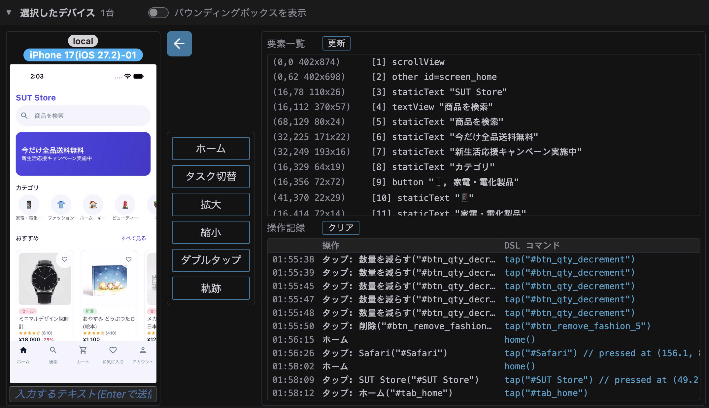
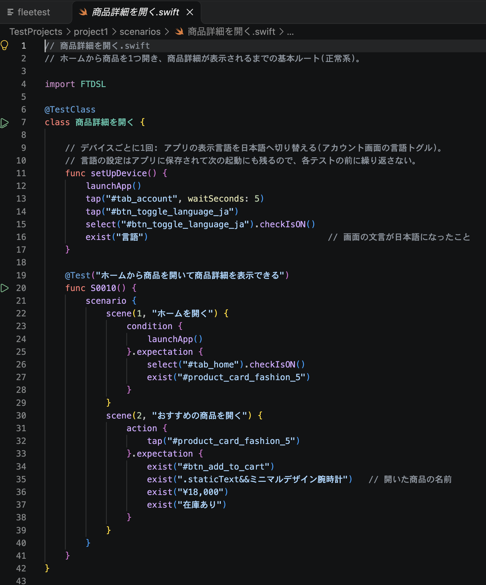

# クイックスタート

[in English](quick-start.md)

fleetest をインストールし、サンプルアプリを対象に、テストシナリオの作成と実行を体験するための最短手順です。

## 1. 環境

本ツールは Apple silicon の Mac、macOS 26以降で動作します。環境の詳細は[環境](overview/environments_ja.md)を参照してください。

## 2. 事前準備

以下をインストールしてください。

- **Xcode 27.2以降**
  - <https://apps.apple.com/jp/app/xcode/id497799835>
  - インストールしたら Xcode のアプリを一度起動し、最初に表示される画面で、必要なコンポーネントをインストールしてください。iOS Simulator のランタイムは、後の手順で必要になったときに自動でインストールされます。
- **Homebrew**
  - <https://brew.sh/ja/>
  - macOS 用のパッケージ管理ツールです。公式サイトにあるコマンドをターミナルで実行してインストールします。
- **VSCode**
  - <https://code.visualstudio.com/docs/setup/mac>
  - シナリオの編集・実行と、AIアシスタントとのやり取りに使います。
- **Android SDK(adb・Command-line Tools)**(Android をテストする場合)
  - <https://developer.android.com/studio/install?hl=ja>
  - Android Studio をインストールすると、adb を含む Android SDK と、Emulator を作るのに要る Java が入ります。Command-line Tools が入っていなければ、後の手順で AIアシスタントがインストールしてよいか確認します(Android Studio の SDK Manager の「SDK Tools」タブで先に追加しておくこともできます)。
- **AIアシスタント(Claude Code など)**
  - MCP に対応した AIアシスタントをインストールしてください。Claude Code や Codex の場合は VSCode 拡張からインストールできます。

## 3. fleetest のインストール

1. Finder で**テスト専用の新規フォルダ**（myTestなど）を作成します

2. 作成したフォルダを VSCode で開きます

3. AIアシスタント(Claude Code 拡張など)を起動して次のように指示します(所要時間: 約5分)

```text
https://github.com/wave1008/fleetest をこのフォルダの隣に clone して
../fleetest/.claude/skills/fleetest-setup/SKILL.md の手順でセットアップして。
```

4. **Claude Code 以外の AIアシスタント**を使う場合は、セットアップの途中で MCP を登録するか聞かれるので、登録してください

5. インストールが完了すると、AIアシスタントが環境の確認結果(`fleetest doctor`)を報告します。エラーが報告されていないことを確かめます(FM の行は ❌ でも先へ進めます)

6. VSCode を再起動します

7. VSCode の下部のステータスバーに表示される **fleetest** をクリックします。デバイスモニターが開きます

   

## 4. サンプルアプリの準備

サンプルアプリ
([sut-ec-mobile](https://github.com/wave1008/sut-ec-mobile)。Compose Multiplatform の EC 買い物アプリ)を
セットアップし、そのサーバー(Kotlin(Ktor)+ PostgreSQL)を fleetest に宣言して、アプリをビルドします。

### AIへの指示文

```text
https://github.com/wave1008/sut-ec-mobile をこのフォルダの隣に clone して(既にあれば git pull で最新にして)、このフォルダで bash ../sut-ec-mobile/fleetest/prepare.sh を実行して。
続けて bash ../sut-ec-mobile/fleetest/build.sh を実行してアプリをビルドして。
```

期待する結果:

- Apple Container がインストールされます。
- サーバーのコンテナイメージがダウンロードされます。
- テストプロジェクト `project1` が作成されます。
- `TestProjects/project1/workspace/scripts/compose.yaml` が作成されます。
- アプリのビルドに使う JDK 25 がインストールされます。
- アプリがビルドされます。iOS のランタイムが未導入なら、数 GB の取得で数分〜数十分かかります。

<details>
<summary><b>手動で実行する場合(クリックで詳細表示)</b></summary>

作業フォルダで実行します。

```bash
git clone https://github.com/wave1008/sut-ec-mobile.git ../sut-ec-mobile
bash ../sut-ec-mobile/fleetest/prepare.sh
bash ../sut-ec-mobile/fleetest/build.sh
#   -> App (iOS): …/sut-ec-mobile/build/ios-sim/Build/Products/Debug-iphonesimulator/iosApp.app
#   -> App (Android): …/sut-ec-mobile/androidApp/build/outputs/apk/debug/androidApp-debug.apk
```

`../sut-ec-mobile` が既にあるときは、clone の代わりに `git -C ../sut-ec-mobile pull` で最新にします。

テストプロジェクトの名前を変えるときは、`bash ../sut-ec-mobile/fleetest/prepare.sh <名前>` のように渡します。

`build.sh` は Android SDK が無ければ iOS だけをビルドします。片方の OS だけをビルドするときは `ios` か `android` を渡します(例: `bash ../sut-ec-mobile/fleetest/build.sh ios`)。

</details>

## 5. プロファイルを用意する

ステップ4でビルドしたアプリを使って、アプリプロファイルと実行プロファイルを作成します。

### AIへの指示文

```text
project1 に、sut-ec-mobile のアプリのプロファイルを作成して。

iOSアプリのプロファイル
表示名： SUT Store
アプリID: com.sutec.mobile.ios
アプリの配布場所： ../sut-ec-mobile/build/ios-sim/Build/Products/Debug-iphonesimulator/iosApp.app
Simulator 2台

Androidアプリのプロファイル　（Androidアプリがある場合）
表示名： SUT Store
アプリID: com.sutec.mobile.android
アプリの配布場所： ../sut-ec-mobile/androidApp/build/outputs/apk/debug/androidApp-debug.apk
Emulator 2台
```

<details>
<summary><b>手動で実行する場合(クリックで詳細表示)</b></summary>

作業フォルダで実行します。プロファイルは、ステップ4で作られたテストプロジェクト project1 に作られます。

```bash
# iOS
../fleetest/.build/debug/fleetest profile setup --platform ios --app-id com.sutec.mobile.ios --auto-device --count 2 --app-name "SUT Store" \
  --app-path ../sut-ec-mobile/build/ios-sim/Build/Products/Debug-iphonesimulator/iosApp.app

# Android
../fleetest/.build/debug/fleetest profile setup --platform android --app-id com.sutec.mobile.android --auto-device --count 2 --app-name "SUT Store" \
  --app-path ../sut-ec-mobile/androidApp/build/outputs/apk/debug/androidApp-debug.apk
```

`--app-name` を省略するとプロジェクト名になり、ホーム画面のアイコン名と食い違って実行の開始時に警告が出ます。
`--app-path` にビルドしたアプリを渡すと、実行時にデバイスへ自動でインストールされます。
`--auto-device` は、最新の iOS ランタイムと最新の Pixel を使う Simulator/Emulator を自動で選びます
(足りなければ作成します。iOS のランタイムが未導入のときは数 GB をダウンロードするので数分〜数十分かかります。
起動していないものは実行時に自動で起動します)。アプリプロファイルの名前は `ios-app`・`android-app`、実行プロファイルの名前は `ios-run`・`android-run` になります。
`--count 2` は、その実行プロファイルの該当 OS のデバイスを全部で2台にします(同じ内容の既存デバイスは番号の小さい順に再利用し、足りない分を作ります。指示文の「Simulator 2台」「Emulator 2台」と同じです)。あとから VSCode 拡張のデバイスモニターの「プロファイル」タブにある「デバイスを追加」でも足せます。
Android のシステムイメージが未導入のときは、Android SDK のライセンスに同意する `--accept-licenses` を付けないとコマンドが断ります(ライセンスの内容は断ったときの表示で確かめてください)。

</details>
<br>

VSCode のデバイスモニターの「プロファイル」タブを開き、アプリプロファイルと実行プロファイルが作成されたことを確認します。


期待する結果:

- 「プロファイル」タブに実行プロファイルとして ios-run と android-run(それぞれデバイス2台)が作成されます。Android SDK が無ければ ios-run だけです。

## 6. サンプルアプリを起動する

サンプルアプリのサーバーを起動し、デバイスでアプリを起動して、デバイスモニターから自分の手で操作してみましょう。

### AIへの指示文

```text
project1 のサーバーを起動して。
iOS のデバイス1台に SUT Store アプリを入れて起動して。
```

- MCPの許可ダイアログが表示された場合は許可してください。
- Android で実行したい場合は「iOS」を「Android」に読み替えてください。

続けて、デバイスモニターで操作します。

グリッドビュー(選択したデバイス)に出たアプリの画面を操作できます。いろいろ操作してみてください



サーバーは止めるまで動き続け、次のステップのシナリオ作成でもそのまま使います。止めるときは「project1 のサーバーを止めて」と指示します。

<details>
<summary><b>手動で実行する場合(クリックで詳細表示)</b></summary>

サーバーは作業フォルダで起動・停止します。

```bash
../fleetest/.build/debug/fleetest services up --project project1
../fleetest/.build/debug/fleetest services down --project project1
```

デバイスモニターの操作は[VSCode で見る](tutorial/watching_in_vscode_ja.md)の「自分の手で触る(ライブ操作)」を参照してください。

</details>

## 7. シナリオを作る

商品を開くまでの基本ルートのテストを作成してみましょう。

### AIへの指示文

```text
project1 で、SUT Store アプリの「商品詳細を開くテスト」を iOS で1本作成して。ファイル名は 商品詳細を開く.swift にして。
ホームから商品を1つ開いて商品詳細が表示されるまでの基本ルート(正常に進む流れ)を確かめる。アプリを日本語モードに切り替える処理は setUpDevice に書いて。
シナリオのファイル名を報告したら終わりにして。
```

- MCPの許可ダイアログが表示された場合は許可してください。
- `setUpDevice` は、テストの前にデバイスごとに1回だけ行う準備を書く場所(関数)です。
- Android の場合は「iOS で」を「Android で」に読み替えてください。
- AIアシスタントはデバイス上でアプリを起動し、画面を操作しながら要素を読み取って、その流れをシナリオに落とします。

期待する結果:

- `scenarios/` にシナリオが1本できます。

<details>
<summary><b>手動で実行する場合(クリックで詳細表示)</b></summary>

自分で書くときは[テストクラスの作成](reference/testclass/creating_testclass_ja.md)を参照してください。

サーバーを手で起動してからテストを作り、終わったら止めます。

```bash
../fleetest/.build/debug/fleetest services up
../fleetest/.build/debug/fleetest services down
```

</details>

<br>



## 8. デバイスで実行する

作成したシナリオを実行してみましょう。

### AIへの指示文

```text
project1 のシナリオを ios-run プロファイルで実行して。
```

- MCPの許可ダイアログが表示された場合は許可してください。

※Android で作ったシナリオなら「android-run プロファイルで実行して」と指示します。


期待する結果:

- テストセッションタブに結果が出ます。

<details>
<summary><b>手動で実行する場合(クリックで詳細表示)</b></summary>

```bash
../fleetest/.build/debug/fleetest run --profile ios-run
```

`--profile` には、ステップ5で用意した実行プロファイルの名前(`ios-run`。Android なら `android-run`)を渡します。
アプリ・デバイス・実行時設定はそこから解決されます。

VSCode からは **Test Explorer** でシナリオを選び、**実行**をクリックします。
初めて実行する前に、コマンドパレットの `fleetest: 実行プロファイルを選択` で使う実行プロファイル(例: `ios-run`)を
選んでおきます。実行プロファイルが1つしか無いときは、選ばずに実行してもそれが自動で選ばれます。

</details>

## 9. 結果を見る

実行のたびに `TestProjects/<プロジェクト>/reports/` にシナリオごとの Markdown
レポートが出ます。


失敗したときは、サーバーのログが `TestProjects/<プロジェクト>/results/runs/<年-月>/<runID>/services/server.log` に残ります。

レポートを要約し、テスト結果を分析してみましょう。

### AIへの指示文

```text
project1 の直近の実行結果を要約し、失敗があればレポートから原因を調べて。シナリオはまだ直さないで。
```

期待する結果:

- 失敗の要約が返ります。

<details>
<summary><b>手動で実行する場合(クリックで詳細表示)</b></summary>

`reports/` のレポートを開きます。VSCode では Test Explorer が成否を直接表示し、そこからレポートを
開けます。

</details>

## 10. トラブルシュート

問題が起きたら AIアシスタントに相談してください。よくある症状と切り分けは
[トラブルシューティング](in_action/troubleshooting_ja.md)にまとめてあります。

<br>

次へ: [fleetest の使い方の基本](tutorial/basic_usage_ja.md)

### Link
- [index](index_ja.md)
