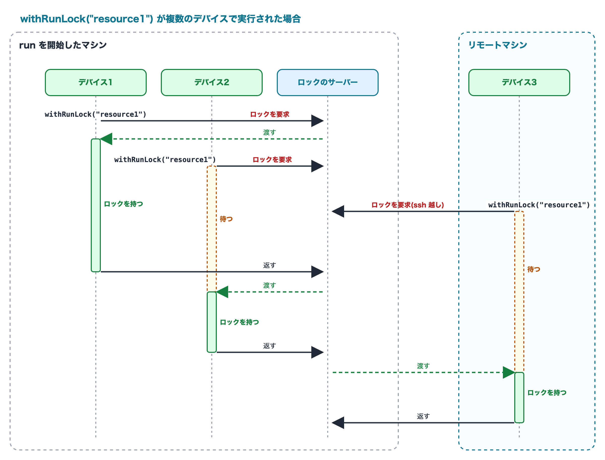

# run 全体のロック(withRunLock)

[in English](run_lock.md)

1つしかない資源を、デバイスの操作をまたいで占有するときに使います。占有したい処理を1つのロックで包むと、他のシナリオは終わるまで待ちます。



ロックは渡した名前(キー)で区別します。同じキーを渡したシナリオどうしだけが排他され、別のキーなら同時に実行されます。排他されるのは、1つの run の中のシナリオどうしだけです。同時に走る別の run(ほかの人の run や CI の run)とは排他されないので、run をまたいで守りたい資源はテスト用サーバーの DB などで排他します。待っているシナリオは、ロックを要求した順(先着順)に取ります。ロックのサーバーは run を開始したマシンで動き、リモートマシンのシナリオも ssh 越しに同じサーバーへ要求します。待った時間は `scenarioTimeout` に数えません。

## 関数

| 関数 | 説明 |
|---|---|
| `withRunLock(キー..., waitSeconds:) { }` | run の他のどのシナリオもそのキーを持っていない間だけブロックを実行します。取れるまで待ちます。待つのはその run の最も長い `scenarioTimeout` までで、`waitSeconds:` で短くできます(取れなければステップの失敗)。 |

## 例

```swift
withRunLock("resource-name") {
    // ロックが必要な何らかの処理
}
```

画面から読む値を **run の中で1回だけ**読み、全マシン・全クラスで共有するには(`beforeRun()` はデバイスを使えません)、各テストの先頭でロックの中で読みます。最初に着いた1本だけが読みます。

```swift
withRunLock("shop") {
    if readRunMemo("shop").isEmpty { select("#shop_name").runMemoTextAs("shop") }
}
```

ロックの中の `readRunMemo` は最新の値を返すので、後のテストは値が入っているのを見て読みを飛ばします。

## 注意点

- ロックのブロックの中でロックを呼ぶ(入れ子にする)ことはできません。
- テストを同時に走らせる必要がなく、ロックの複雑さを回避したい場合は、`@RunInOrder` を使用してテストの順次実行を検討してください。

### Link
- [index](../../index_ja.md)
